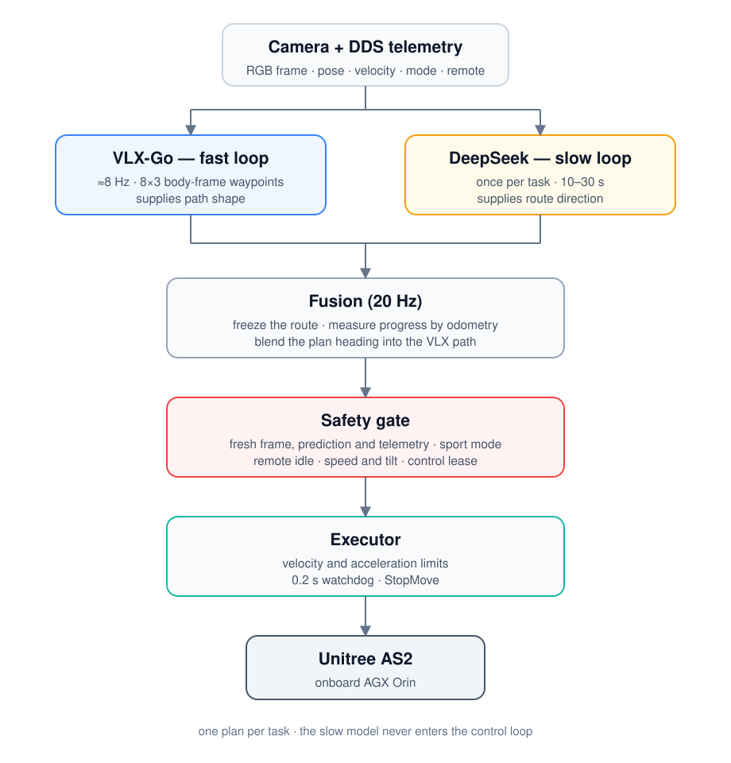
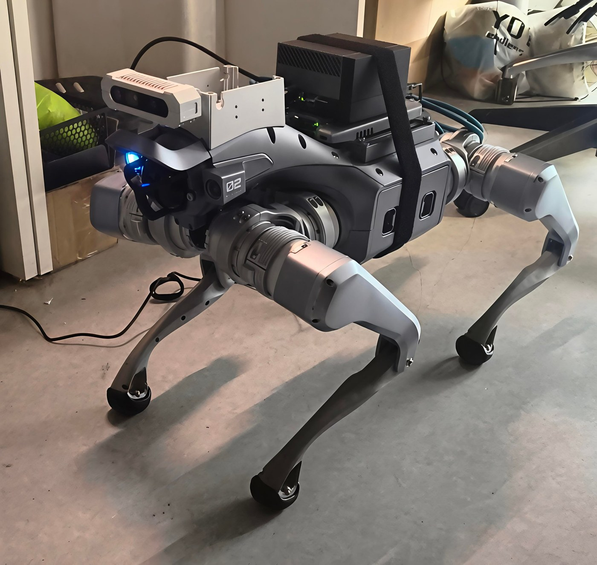
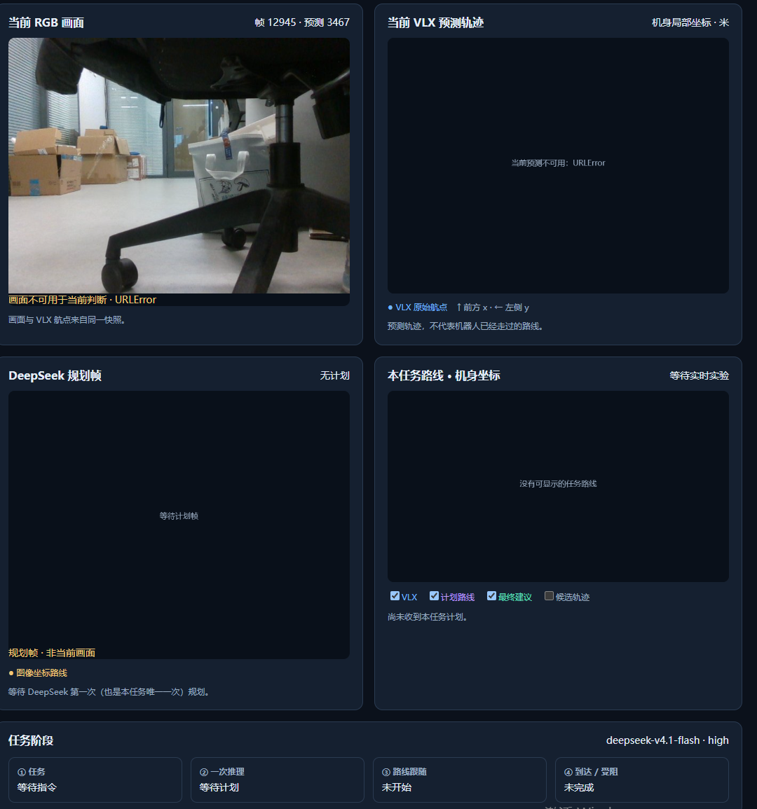
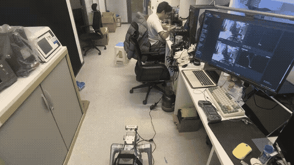
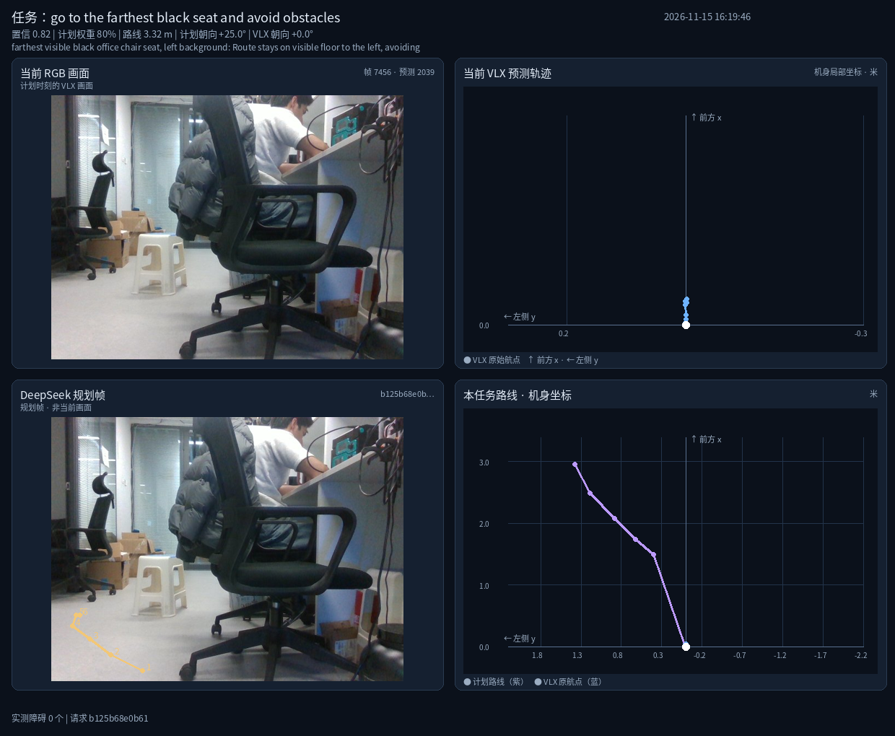

<p align="center">
  
</p>

<h1 align="center">AS2 Track Harness</h1>

<p align="center">
  <b>DeepSeek × VLX.</b> A deployment harness for a fast VLA policy and a slow
  VLM planner on a Unitree AS2 quadruped.
</p>

<p align="center">
  <a href="LICENSE"></a>
  
  <a href="#quick-start-no-robot-required"></a>
  <a href="https://github.com/Appendix41/as2-track-harness/actions/workflows/ci.yml"></a>
  <a href="#safety--limitations"></a>
</p>

<p align="center">
  English | <a href="README.zh-CN.md">中文</a>
</p>

---

## 🌟 特别鸣谢

<table>
  <tr>
    <td width="180" align="center">
      <a href="https://api.entropicecho.com/">
        
      </a>
    </td>
    <td>
      <a href="https://api.entropicecho.com/"><strong>Entropic Echo</strong></a><br><br>
      感谢 <strong>Entropic Echo</strong> 对本项目开发过程提供的支持。
      在资料整理、代码分析、问题排查与开发调试过程中，Entropic Echo提供的API服务为项目推进提供了便利与帮助。
    </td>
  </tr>
</table>
<br>

> Note: the Entropic Echo API relay used by this project (api.entropicecho.com) is set up and maintained by the author.

## What this is

VLX-Go is small and fast: about 8 Hz on the Orin, one frame in, 8×3 body-frame
waypoints out. Its weakness is judgement. In a cluttered lab it gets the semantic
parts wrong: which black chair is the far one, where a target went behind an
obstacle, whether the route still makes sense after the view changes. The
monocular projection flattens distance, so "go to the farthest black seat" is
exactly the instruction it struggles with.

The harness adds a slow planner for that part, and the machinery needed to run the
pair on a robot. DeepSeek reads the frame and the instruction once per task, before
the robot moves, and returns a ground route; asking it once keeps its 10–30 s
latency out of the control loop. The split follows Galbot's integration of Astra
into a VLA pipeline.

- **Fusion.** The route is projected into the body frame and frozen. Every 20 ms
  tick re-expresses it through the current pose, measures progress along it, and
  blends its heading into the VLX waypoints, limited to 6° per tick.
- **Gate.** A command leaves only if the frame, prediction and telemetry are fresh,
  the robot is in sport mode, no other controller owns it, the remote is idle, and
  speed and tilt are in bounds.
- **Executor.** A separate process re-checks the packet, applies velocity and
  acceleration limits, runs a 0.2 s watchdog, and always ends with `StopMove`.

A task is the VLX task key: boot id, stream, instruction revision and instruction.
Only a new key starts a new plan. The route is not replanned mid-task.

## Architecture

<p align="center">
  
</p>

Fast policy at camera rate, slow planner once per task, and one gate that every
command has to pass.

```
idle --new task--> planning --plan accepted--> executing --arrival / timeout--> completed
                       |                                                     |
                       +-- rejected / timeout --> blocked <------------------+
```

The [architecture document](docs/ARCHITECTURE.md) has the coordinate contract, the
fusion formulas and the gate order.

### VLX-Go model

The fast policy is external; this repository only consumes its 8×3 output. Its
architecture, for reference:

<p align="center">
  <a href="assets/vlx-go-architecture.png"></a>
</p>

- 31 history frames × 4 tokens (124) plus the current frame (64) give 188 visual
  tokens, 1536 dimensions each after DINOv3 and SigLIP features are aligned and
  pooled.
- A shared adapter maps 1536 → 1024. The instruction becomes L text tokens; time
  indicators and one action-query token are appended.
- Qwen3 runs one forward pass. The action-query position goes through a 3-layer MLP
  (1024 → 24) and becomes 8×3 body-frame waypoints.
- The executor uses waypoint 2 divided by 0.1 s as forward, lateral and yaw
  velocity.

Details and tensor shapes: [docs/VLX_GO.md](docs/VLX_GO.md). The figure is from the
upstream project (om-ai-lab, arXiv:2610.19361); the model and weights are not
included here.

## Quick start (no robot required)

```bash
git clone https://github.com/Appendix41/as2-track-harness.git
cd as2-track-harness
python3.11 -m venv .venv && . .venv/bin/activate
pip install -e '.[vision]'
bash scripts/test.sh
```

Mock loop with no camera, API key or robot:

```bash
bash scripts/mock_preview.sh --port 8765          # terminal A
bash scripts/shadow.sh --config config/shadow.json --duration 15 --port 0   # terminal B
```

Replay a recorded run:

```bash
PYTHONPATH=src python -m vlx_async.replay \
  --predictions examples/demo_run/predictions.jsonl --max-records 200
```

## Running on an AS2

<p align="center">
  
</p>

<p align="center"><em>Unitree AS2. Intel RealSense D435i on the front bracket; the Jetson AGX Orin on the back runs VLX-Go, the planner client and the DDS stack.</em></p>

The repository ships no models. You supply:

- a **VLX-Go preview service** on `127.0.0.1:8765` serving `/control.json` and
  `/state.json`;
- **DDS telemetry** via `unitree_sdk2py` and Cyclone DDS, or the snapshot from
  `scripts/telemetry_readonly.sh`;
- a **control lease** (and optionally your manual controller) through
  `VLX_CONTROLLER_LOCK` and `VLX_STACK_ROOT`;
- an **OpenAI-compatible endpoint** (`base_url`, `model`, `DEEPSEEK_API_KEY`).

VLX-Go-1.0 and SigLIP weights are public on Hugging Face, DINOv3 is gated, and the
inference code is `om-ai-lab/VLX-Go`. Inference can run on another machine; the
adapter stays on the robot host (see [remote inference](docs/REMOTE_INFERENCE.md)).

VLX-Go also runs on its own: the preview service and the shadow loop show its raw
8×3 paths without a planner request. The executor still requires an accepted plan,
so this build has no VLX-only motion mode.

<p align="center">
  
</p>

<p align="center"><em>The browser trial page. Limits are entered per run; the values above are a bench setting. The shipped defaults are much lower (0.05 / 0.03 / 0.10 m/s) and are the ones to start from.</em></p>

<p align="center">
  
</p>

<p align="center"><em>The observation page: RGB frame, VLX path, the one DeepSeek plan frame, the task route and the task phase. This capture was taken with the preview service offline, so each panel shows the reason (`URLError`) instead of reusing a stale route.</em></p>

```bash
DEEPSEEK_API_KEY=... bash scripts/observe.sh --port 8768   # dashboard on loopback
bash scripts/fusion_trial.sh --duration 10                 # dry run
bash scripts/fusion_trial.sh --execute --duration 5 \
  --speed 0.05 --lateral-speed 0.03 --yaw-speed 0.10 \
  --linear-acceleration 0.10 --yaw-acceleration 0.20
```

Read [SAFETY.md](docs/SAFETY.md) before the first real run, and
[RUNBOOK.md](docs/RUNBOOK.md) for prerequisites and error reasons.

## Results

All of it was run on our AS2 with the instruction
`go to the farthest black seat and avoid obstacles`. VLX-Go runs on the onboard
Orin at about 8 Hz; DeepSeek is called once per task.

<p align="center">
  <a href="assets/demo.mp4"></a>
</p>

<p align="center"><em>Demo clip (10 s, looping). Click to open the MP4.</em></p>

<p align="center">
  
</p>

<p align="center"><em>One step from the same run. VLX gives no usable direction here (heading +0.0°, its points stay near the origin); DeepSeek plans a 3.32 m route at +25.0°. The harness blends 80% of that heading into the VLX path, which is what turns the robot toward the far chair. This is the reason for the slow planner.</em></p>

| What | Result | N |
| --- | --- | --- |
| Unit tests | 170 passing, CPU only | 170 |
| On-device VLX | ≈8.2 Hz output, ≈19.9 Hz local loop | 1 run, 65 s |
| Planner latency | 10.3 – 24.0 s per image request | 18 requests |
| Real bounded sessions | 2 – 172 `Move` RPCs, longest 55.6 s | 22 sessions |

## Safety & limitations

> [!WARNING]
> Uncertified research code that can move a 20+ kg quadruped.
>
> - No obstacle sensing by default: `motion_gates.json` and `depth.json` ship
>   `false`. The physical remote, the watchdog, the speed/acceleration caps and the
>   telemetry gates are the only bounds.
> - The gate is Python on the same machine as the planner client. A crash, a kernel
>   stall, DDS loss or a robot fault defeats it.
> - One plan per task: a scene change mid-task needs a new task.
> - No warranty, no weights, Apache-2.0 as is.

Keep the remote in hand and a second person at the robot. Details:
[SAFETY.md](docs/SAFETY.md).

## Documentation

- [Architecture](docs/ARCHITECTURE.md) — data flow, lifecycle, fusion, gate order.
- [Safety](docs/SAFETY.md) — limits, stop behaviour, what is not provided.
- [Runbook](docs/RUNBOOK.md) — install, demo, dashboard, real-robot checklist.
- [Configuration](docs/CONFIGURATION.md) — every field and its range.
- [Remote inference](docs/REMOTE_INFERENCE.md) — running the planner off the robot.
- [Example](examples/README.md) — the recorded task and how to replay it.

Contributions follow [CONTRIBUTING.md](CONTRIBUTING.md); security reports go through
[SECURITY.md](SECURITY.md).

## License

Apache-2.0. No model weights are redistributed; VLX-Go, DINOv3 and SigLIP stay
under their own licences. Attributions are in [NOTICE](NOTICE).

If this code helps your work:

```bibtex
@software{as2_track_harness_2026,
  title  = {AS2 Track Harness (DeepSeek × VLX): an asynchronous VLA + VLM navigation harness for the Unitree AS2},
  author = {{AS2 Track Harness contributors}},
  year   = {2026},
  url    = {https://github.com/Appendix41/as2-track-harness},
  note   = {Research prototype; not safety certified}
}
```
