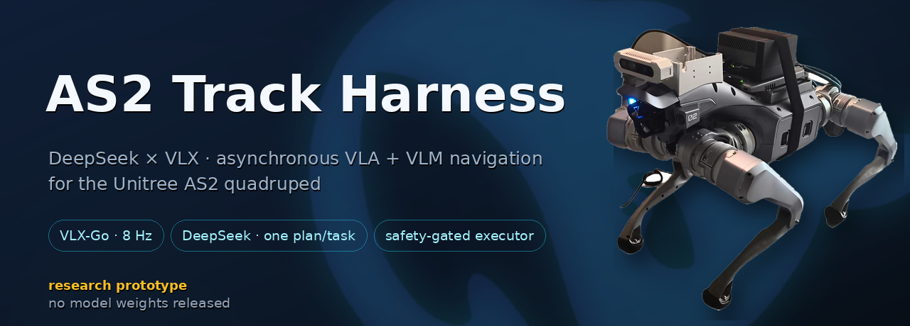
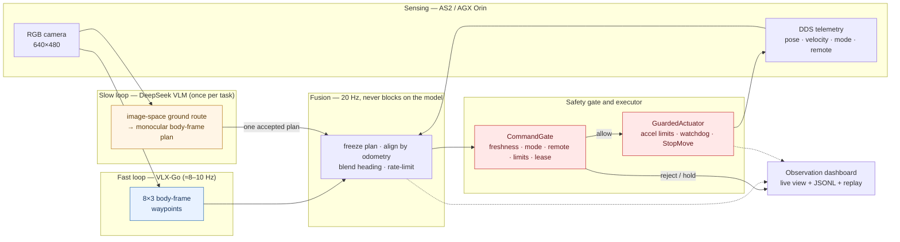
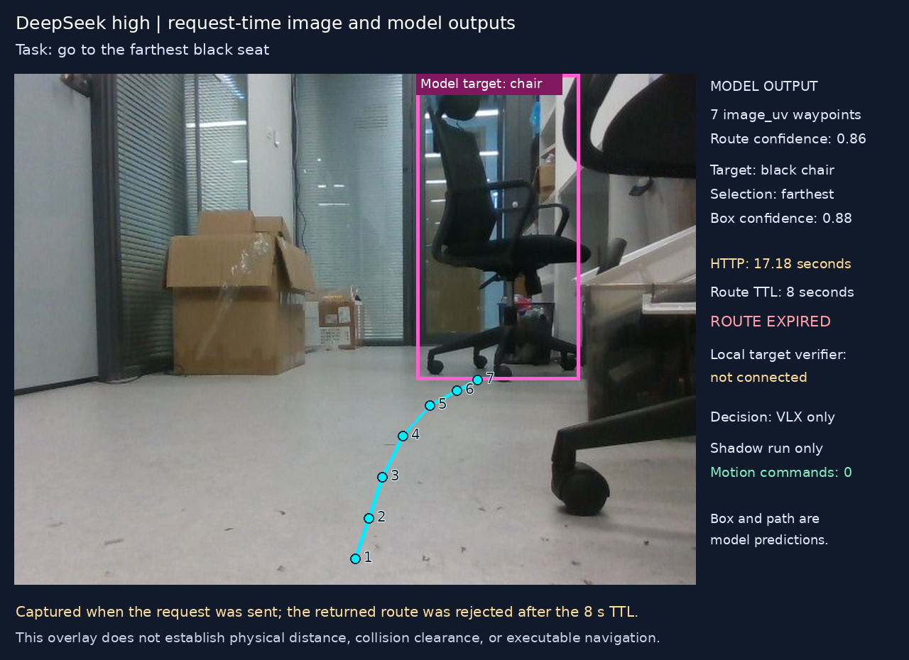
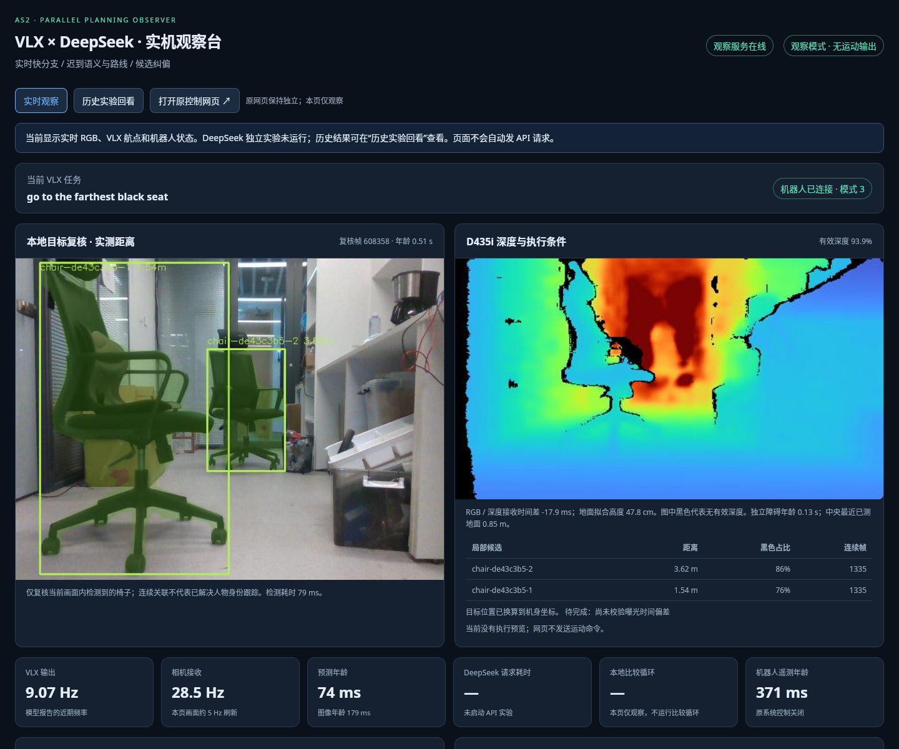
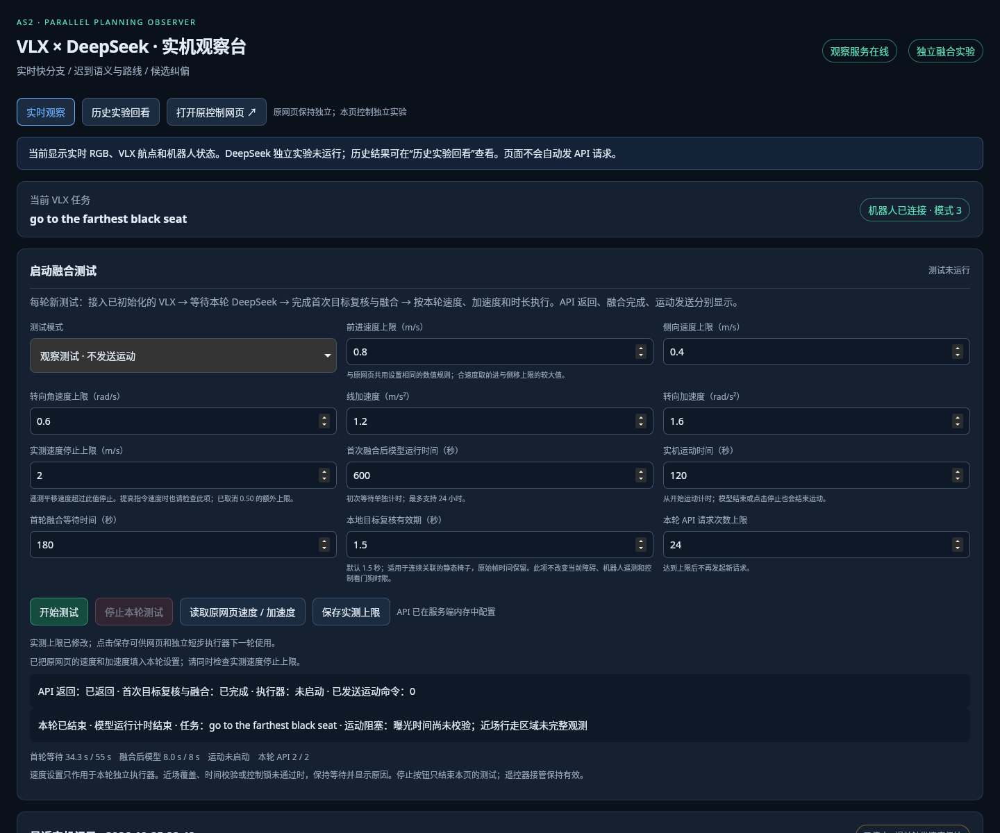

<p align="center">
  
</p>

<h1 align="center">AS2 Track Harness</h1>

<p align="center">
  <b>DeepSeek × VLX.</b> Navigation code we run on a Unitree AS2: VLX-Go
  waypoints at camera rate, one DeepSeek plan per task, a safety-gated executor,
  and a read-only dashboard.
</p>

<p align="center">
  <a href="LICENSE"></a>
  
  <a href="#quick-start-no-robot-required"></a>
  <a href="#safety--limitations"></a>
  <a href="NOTICE"></a>
  [](https://github.com/Appendix41/as2-track-harness/actions/workflows/ci.yml)
</p>

<p align="center">
  English | <a href="README.zh-CN.md">中文</a>
</p>

---

## Status

Research code, November 2026. The components run end to end, and the robot has
moved under them in short bounded sessions. Continuous navigation and obstacle
avoidance have not been shown. Nothing here is safety certified, and execution
is disabled in every shipped configuration.

- Runs offline: 170 unit tests, the mock shadow loop, replay of recorded runs.
- Needs your hardware: a VLX-Go preview service, DDS telemetry, an AS2 bridge.
- Not implemented: mid-task replanning, obstacle avoidance (depth is off by
  default), metric ground truth, English labels in the dashboard.
- Not in this repository: VLX-Go weights and inference code, the AS2 controller
  stack, a DeepSeek key.

## News

- **2026-11-13** — First public release. Code extracted from the lab deployment,
  sanitized, documented, CI added.
- **2026-11-09** — One planner call per task, made before departure. The depth and
  obstacle chain was removed from the default path.
- **2026-10-25** — First step on the real AS2: 17 `Move` calls, 4.27 cm of
  odometry, stopped by the observed-speed gate.

## What this is

This is the glue between two models that run at very different speeds. VLX-Go
returns 8×3 body-frame waypoints at roughly camera rate (about 8 Hz on our
Orin). DeepSeek takes 10–30 s for one request, so it is asked exactly once per
task rather than in the loop.

A task is the VLX `task_key`: instruction, revision, stream and boot id. A new
key opens a new planning phase; nothing else does.

1. While the robot is still, one camera frame and the instruction go out. The
   reply is a ground route in image pixels. It is projected to the body frame
   with the declared camera mount and frozen.
2. On every 20 ms tick the frozen route is re-expressed through the current
   pose, progress is measured along it, and a heading is derived from a
   lookahead point and the route endpoint.
3. That heading is blended into the VLX heading by a weight, limited to 6° per
   tick, and applied as a rotation of the VLX path.
4. The executor turns the second waypoint into `vx, vy, wz`, clamps it to the
   configured limits, ramps it, and only sends when the gate passes.
5. If the plan is rejected, late, or the route drifts, the robot holds. There is
   no fallback mode that drives on VLX alone.
6. Arrival is `remaining_route_m ≤ 0.35 m`, or `max_travel_m`; both are measured
   by odometry along the route, not by GPS.

The planner is not trusted with distance. The monocular projection depends on
camera height and pitch, so the route is used for direction and progress. The
VLX path supplies the shape; the plan supplies the direction.

This is not a trained policy, a benchmark or a certified controller. It is the
deployment and validation layer; the models are external.

## Architecture



The fast loop is a 20 Hz thread that reads the preview and never waits for the
model. The slow worker keeps at most one request in flight and one result
pending. The executor is a separate process; it reads decision packets from
disk and validates them again.

Lifecycle:

```
idle --new task_key--> planning --plan accepted--> executing --arrival / timeout--> completed
                          |                                                     |
                          +-- plan rejected / plan timeout --> blocked <--------+
```

During `executing` no planner request is possible. The route is frozen in the
body frame captured with the request image. [`docs/ARCHITECTURE.md`](docs/ARCHITECTURE.md)
has the fusion formulas, the coordinate contract and the gate order.

<p align="center">
  
</p>

<p align="center"><em>Left: the frame the planner saw. Middle: the image-space route it returned. Right: the fused body-frame path the executor consumes.</em></p>

## Quick start (no robot required)

Offline work needs Python and numpy. The dashboard extras add OpenCV and Pillow.

```bash
git clone https://github.com/Appendix41/as2-track-harness.git
cd as2-track-harness
python3.11 -m venv .venv && . .venv/bin/activate
pip install -e '.[vision]'

bash scripts/test.sh          # Ran 170 tests in about 12 s ... OK
```

Mock loop, no camera, no API key, no robot:

```bash
# terminal A: synthetic VLX preview on loopback
bash scripts/mock_preview.sh --port 8765

# terminal B: read-only runner with the mock planner
bash scripts/shadow.sh --config config/shadow.json --duration 15 --port 0
```

`shadow.sh` prints a JSON line with the dashboard URL. The mock planner answers
after 7 s, the plan is accepted, the task reaches `executing`, and the run lands
in `runs/shadow_<timestamp>/`. The runner rejects any config with
`execution_enabled != false`, so this path cannot move the robot.

Replay a saved run, or the recorded example task:

```bash
bash scripts/view_report.sh runs/shadow_<timestamp> --port 0
PYTHONPATH=src python -m vlx_async.replay \
  --predictions examples/demo_run/predictions.jsonl --max-records 200
```

<p align="center">
  
</p>

<p align="center"><em>Dashboard: current frame, VLX waypoints, the task's single DeepSeek plan, the fused route and the task phase.</em></p>

| Goal | Command | Robot? | API? |
| --- | --- | --- | --- |
| Unit tests (170) | `bash scripts/test.sh` | no | no |
| Mock shadow run | `bash scripts/mock_preview.sh` + `bash scripts/shadow.sh` | no | no |
| Replay a recorded run | `PYTHONPATH=src python -m vlx_async.replay --predictions …` | no | no |
| View a run offline | `bash scripts/view_report.sh runs/<run>` | no | no |
| One real planner request | `PYTHONPATH=src python scripts/probe_planner.py --enable-api` | no | yes, one call |
| Observation dashboard | `bash scripts/observe.sh --port 8768` | no | no |
| Executor dry run | `bash scripts/fusion_trial.sh --duration 10` | no | no |

## Running on an AS2

You need four things, none of them shipped here:

1. **A VLX-Go preview service** on `127.0.0.1:8765` serving `/control.json` and
   `/state.json` in the shape `src/vlx_async/source.py` expects.
2. **DDS telemetry** (`unitree_sdk2py` + Cyclone DDS).
   `bash scripts/telemetry_readonly.sh` writes a read-only `SportModeState_` /
   `LowState_` snapshot to `runs/perception_live/telemetry.json`. Set
   `VLX_DDS_LIB` if the DDS libraries are not on the default loader path.
3. **A control lease and, optionally, your existing manual controller.** The
   harness will not fight another owner. Point `VLX_CONTROLLER_LOCK` and
   `VLX_STACK_ROOT` at your deployment.
4. **An OpenAI-compatible vision endpoint.** Set `base_url` and `model` in
   `config/deepseek_task.json`, export `DEEPSEEK_API_KEY`. The key stays in
   process memory; tests assert it does not reach configs, snapshots or logs.

### What you need to fetch

The models are public or gated upstream, not here. That is why the repo has no
checkpoints: 4.5 GB of third-party weights plus their licences do not belong in
git.

| Piece | Source | Approval |
| --- | --- | --- |
| VLX-Go-1.0 weights (~1.26 GB) | Hugging Face `omlab/VLX-Go-1.0` | none |
| SigLIP SO400M (~3.5 GB) | `google/siglip-so400m-patch14-384` | none |
| DINOv3 ViT-S/16 (~86 MB) | `facebook/dinov3-vits16-pretrain-lvd1689m` | gated page |
| VLX-Go inference code | GitHub `om-ai-lab/VLX-Go` (Apache-2.0) | none |
| Preview service on `:8765` | a small adapter over the VLX-Go engine; `scripts/mock_preview.py` implements the contract synthetically | you write it |
| AS2 telemetry and command bridge | your Unitree SDK2 deployment and controller | none |

What you can run with each subset:

- Without weights: everything in this repo. Tests, mock loop, replay.
- With weights but without the adapter: the upstream VLX-Go server, not this
  harness. The contract is documented and mocked; a reference adapter is the
  first item on the roadmap.
- With both: the full loop described above.

Inference can also run on another machine. The adapter has to stay on the robot
host so the boot id and monotonic stamps remain local; see
[`docs/REMOTE_INFERENCE.md`](docs/REMOTE_INFERENCE.md).

With an operator at the robot and the remote in hand:

```bash
DEEPSEEK_API_KEY=... bash scripts/observe.sh --port 8768
bash scripts/fusion_trial.sh --duration 10
bash scripts/fusion_trial.sh --execute --duration 5 \
  --speed 0.05 --lateral-speed 0.03 --yaw-speed 0.10 \
  --linear-acceleration 0.10 --yaw-acceleration 0.20
```

Read [`docs/SAFETY.md`](docs/SAFETY.md) before the first real run;
[`docs/RUNBOOK.md`](docs/RUNBOOK.md) lists the prerequisites, expected error
reasons and recovery steps.

<p align="center">
  
</p>

<p align="center"><em>The trial form: per-session limits, shadow or execute mode, and a stop button that is always visible.</em></p>

> Enabling the real API sends the current camera frame to the endpoint you
> configure. The mock and offline paths upload nothing.

## Results

Numbers from our AS2 and AGX Orin, with sample size and date. Some rows come from
the earlier prototype (before the one-plan-per-task change); they are marked.

### Measured

| What | Result | N | Date | Note |
| --- | --- | --- | --- | --- |
| Unit tests | 170 passing | 170 | 2026-11-13 | CPU only |
| Fast policy rate | ≈8.2 Hz VLX output, ≈19.9 Hz local loop | 1 run, 65 s | 2026-10-25 | Bounded slice |
| Planner latency | 10.3 – 24.0 s per image request | 18 requests | 2026-10-25/26 | One image, one gateway, some cached |
| First real step | 17 `Move` RPCs, 0.81 s, 4.27 cm forward | 1 run | 2026-10-25 | Earlier prototype; stopped by the speed gate |
| Bounded real sessions | 2 – 172 `Move` RPCs, longest 55.6 s | 22 sessions | 2026-11-10 | 3 ended on the route/travel bound; arrival not independently measured |
| Mock shadow run | Plan accepted, task reaches `executing`, 0 commands | 1 run | 2026-11-13 | Mock planner, 2 s |

### Not validated

| Claim we do not make | Why |
| --- | --- |
| Continuous navigation over more than a few metres | Only bounded sessions were run |
| Obstacle avoidance on the robot | Depth is disabled by default |
| Metric accuracy of the route | Height/pitch bias; direction only |
| Another robot or room | Joint order, IMU and limits are per-robot work |
| Safety near people | No certified stop integration, no risk analysis |
| Reproducing VLX-Go's published numbers | We use the released model, we do not re-evaluate it |

## Safety & limitations

> [!WARNING]
> **Uncertified research code that can move a 20+ kg quadruped.**
>
> - **No obstacle sensing by default.** `config/motion_gates.json` and
>   `config/depth.json` ship `false`. The physical remote, the watchdog, the
>   speed/acceleration caps and the telemetry gates are the only bounds. The
>   robot will walk into something the operator does not stop it from hitting.
> - **The gate is not a guarantee.** It is Python on the same machine as the
>   planner client. A crash, a kernel stall, DDS loss or a robot fault defeats it.
> - **One plan per task.** A scene change mid-task needs a new task; the harness
>   will not replan.
> - **No warranty.** You supply the weights and the API key; behaviour will
>   differ from ours. Apache-2.0, as is.
>
> Keep the physical remote in hand and a second person at the robot. Read
> [`docs/SAFETY.md`](docs/SAFETY.md) first.

## Configuration

| File | Governs |
| --- | --- |
| `config/shadow.json` | Mock planner (7 s delay) for offline runs |
| `config/deepseek_task.json` | One plan per task, `route` mode, timeouts, travel bound |
| `config/deepseek_high.json` | Hybrid mode (route + target box), high reasoning effort |
| `config/camera_mount.json` | Intrinsics, camera height and pitch for the ground projection |
| `config/motion_gates.json` | Measured-obstacle stop (default `false`) |
| `config/execution_limits.json` | Observed-speed trip, 0.12 m/s |
| `config/depth.json` | Optional depth reader (default `false`; missing file counts as `true`) |

Fusion and task parameters (`plan_weight`, `max_heading_change_rad`,
`plan_lookahead_m`, `arrival_distance_m`, `max_travel_m`, `plan_timeout_s`, …)
are in the same files. Field-by-field reference:
[`docs/CONFIGURATION.md`](docs/CONFIGURATION.md).

## Repository layout

```
as2-track-harness/
├── src/vlx_async/          # harness package: fusion, providers, gates, dashboard
├── tests/                  # 170 unit tests, no hardware or network
├── scripts/                # test, mock_preview, shadow, observe, view_report,
│                           # fusion_trial, telemetry_readonly
├── config/                 # sanitized example configurations
├── examples/demo_run/      # one recorded task: image, plan, 258 VLX predictions
├── assets/                 # banner and figures used by the README
├── docs/                   # ARCHITECTURE, SAFETY, RUNBOOK, CONFIGURATION, REMOTE_INFERENCE
├── .github/                # CI (unittest on 3.11/3.12), issue and PR templates
├── pyproject.toml
├── LICENSE                 # Apache-2.0
└── NOTICE                  # third-party attributions
```

## Documentation

- [`docs/ARCHITECTURE.md`](docs/ARCHITECTURE.md) — data flow, task lifecycle, fusion math, route contract.
- [`docs/SAFETY.md`](docs/SAFETY.md) — gates, limits, stop behaviour, what is not provided.
- [`docs/RUNBOOK.md`](docs/RUNBOOK.md) — install, offline demo, dashboard, real-robot checklist, error reasons.
- [`docs/CONFIGURATION.md`](docs/CONFIGURATION.md) — configuration fields.
- [`docs/REMOTE_INFERENCE.md`](docs/REMOTE_INFERENCE.md) — running inference on another machine.
- [`examples/README.md`](examples/README.md) — the recorded task and how to replay it.

## Roadmap

- [ ] Reference VLX-Go preview adapter (the missing piece for a full real-robot run).
- [ ] Replan only when the instruction or the scene changes.
- [ ] English labels for the dashboard. The HTTP API and logs are already language-neutral.
- [ ] Depth-based local planner that routes around obstacles instead of stopping.
- [ ] Per-robot calibration: joint order and signs, IMU axes, mount extrinsics.
- [ ] Hardware-in-the-loop rig and a recorded end-to-end run.

## Contributing

Issues and pull requests are welcome. Run `bash scripts/test.sh` before opening a
PR; CI runs the same command on Python 3.11 and 3.12. Behaviour changes need a
test, and nothing should make motion the default. See
[`CONTRIBUTING.md`](CONTRIBUTING.md) and [`SECURITY.md`](SECURITY.md).

## Citation

```bibtex
@software{as2_track_harness_2026,
  title  = {AS2 Track Harness (DeepSeek × VLX): an asynchronous VLA + VLM navigation harness for the Unitree AS2},
  author = {{AS2 Track Harness contributors}},
  year   = {2026},
  url    = {https://github.com/Appendix41/as2-track-harness},
  note   = {Research prototype; not safety certified}
}
```

GitHub renders a "Cite this repository" button from
[`CITATION.cff`](CITATION.cff).

## License

- Code and documentation here: Apache-2.0. See [`LICENSE`](LICENSE).
- No model weights are redistributed. VLX-Go and its encoders stay under their
  own licences (VLX-Go: Apache-2.0; DINOv3: gated custom licence; SigLIP:
  Apache-2.0).
- API calls follow your endpoint provider's terms. "Unitree" and "AS2" are
  trademarks used to describe compatibility.
- Attributions: [`NOTICE`](NOTICE).

## Acknowledgements

VLX-Go and OmTrackVLA (`om-ai-lab`) for the fast policy; DeepSeek for the
planner API; the Unitree SDK2 Python bindings and Eclipse Cyclone DDS; the
NVIDIA Jetson AGX Orin; Intel RealSense for the RGB-D camera. Dashboard
conventions follow LeRobot and OpenVLA.
