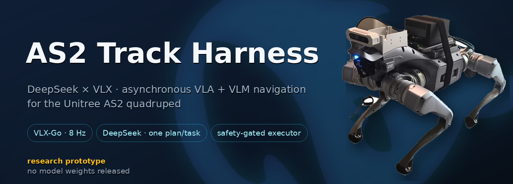
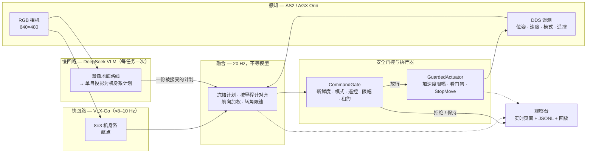
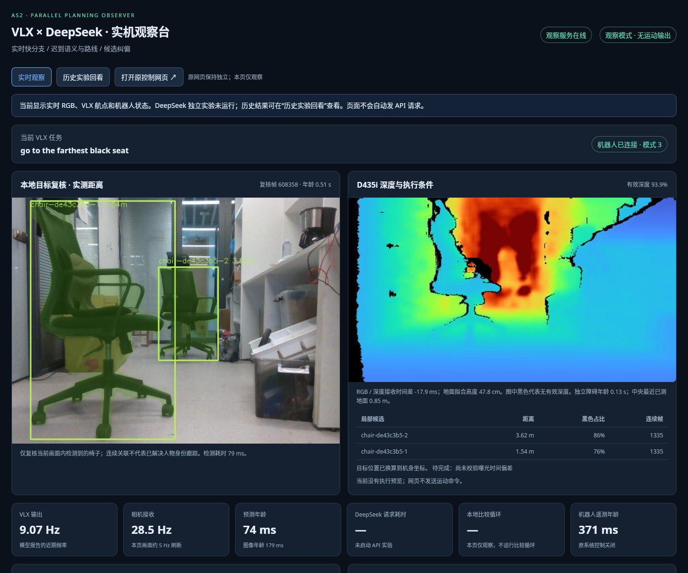
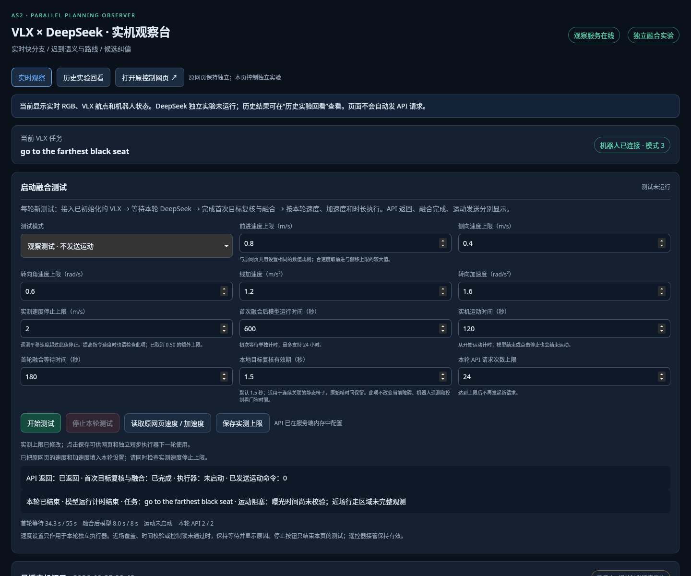

<p align="center">
  
</p>

<h1 align="center">AS2 Track Harness</h1>

<p align="center">
  <b>DeepSeek × VLX。</b>我们跑在 Unitree AS2 上的导航代码：VLX-Go 按相机频率
  输出航点，DeepSeek 每个任务只规划一次，执行器带安全门控，另有一个只读观察台。
</p>

<p align="center">
  <a href="LICENSE"></a>
  
  <a href="#快速开始无需机器人"></a>
  <a href="#安全声明与已知限制"></a>
  <a href="NOTICE"></a>
  [](https://github.com/Appendix41/as2-track-harness/actions/workflows/ci.yml)
</p>

<p align="center">
  <a href="README.md">English</a> | 中文
</p>

---

## 状态

2026 年 11 月的研究代码。各个组件能端到端跑通，机器人也在受控短会话里实际运动过；
连续导航和避障没有验证。没有任何安全认证，所有随仓库发布的配置都关闭了实机执行。

- 离线可跑：170 项单元测试、mock 影子回路、录制回放。
- 需要你的硬件：VLX-Go 预览服务、DDS 遥测、AS2 指令桥接。
- 未实现：任务中途重规划、避障（深度默认关闭）、米制真值、观察台英文标签。
- 不含：VLX-Go 权重与推理代码、AS2 控制栈、DeepSeek key。

## 新闻

- **2026-11-13** —— 首次开源。代码从实验室部署中抽出，脱敏、补文档、加 CI。
- **2026-11-09** —— 改为每个任务只规划一次，出发前完成；默认路径移除深度与障碍链路。
- **2026-10-25** —— 真机首次短步：17 条 `Move`、里程计前进 4.27 cm，被实测速度门控提前停止。

## 这是什么

两个模型速度差得很远，这里是把它们接起来的代码。VLX-Go 以接近相机的频率返回
8×3 机身系航点（我们的 Orin 上约 8 Hz）；DeepSeek 一次请求要 10–30 s，所以每个任务
只问一次，不放进控制回路。

任务身份是 VLX 的 `task_key`：指令、修订号、流、boot id。只有出现新的 key 才会进入
新的规划阶段。

1. 机器人静止时，取一帧图像加指令发出去。返回的是图像坐标系里的地面路线，用声明的
   相机安装参数投影到机身系后冻结。
2. 之后每 20 ms 用当前位姿重新表达这条冻结路线，沿路线累计进度，并由前视点与终点
   方向算出计划航向。
3. 计划航向按权重混入 VLX 航向，每个周期最多转 6°，作为 VLX 路径的旋转量下发。
4. 执行器把第二个航点换算成 `vx, vy, wz`，按配置限幅、按加速度爬升，只有在门控全部
   通过时才发送。
5. 计划被拒、迟到或路线漂移时，机器人保持不动。没有"退回纯 VLX 自己走"的兜底。
6. 到达判据是剩余路线 ≤ 0.35 m，或累计行程到 `max_travel_m`；两者都由里程计沿路线
   计算，不是 GPS。

规划器给出的距离不可信。单目投影受相机高度和俯仰影响，路线只用来定方向和算进度：
VLX 给路径形状，计划给方向。

这不是训练好的策略、不是 benchmark、也不是经过认证的控制器。它只是部署与验证层，
模型在外部。

## 架构



快回路是 20 Hz 的线程，只读预览，永远不等模型；慢线程最多一个在途请求和一个待消费
结果。执行器是独立进程，从磁盘读决策包，并再校验一遍。

```
空闲 --新 task_key--> 规划中 --计划被接受--> 执行中 --到达 / 超时--> 完成
                        |                                        |
                        +-- 计划被拒 / 规划超时 --> 阻塞 <--------+
```

执行阶段不会再发规划请求。路线冻结在请求图像那一刻的机身系里。融合公式、坐标契约和
门控顺序见 [`docs/ARCHITECTURE.md`](docs/ARCHITECTURE.md)。

<p align="center">
  
</p>

<p align="center"><em>左：规划器看到的帧。中：它返回的图像空间路线。右：执行器实际消费的机身系融合路径。</em></p>

## 快速开始（无需机器人）

离线部分只需要 Python 和 numpy；观察台额外要 OpenCV 和 Pillow。

```bash
git clone https://github.com/Appendix41/as2-track-harness.git
cd as2-track-harness
python3.11 -m venv .venv && . .venv/bin/activate
pip install -e '.[vision]'

bash scripts/test.sh          # Ran 170 tests in about 12 s ... OK
```

mock 回路，不需要相机、API key 或机器人：

```bash
# 终端 A：在 loopback 上起合成 VLX 预览
bash scripts/mock_preview.sh --port 8765

# 终端 B：用 mock 规划器跑只读 runner
bash scripts/shadow.sh --config config/shadow.json --duration 15 --port 0
```

`shadow.sh` 会打印一行 JSON，里面有观察台地址。mock 规划器 7 s 后返回，计划被接受，
任务进入 `executing`，结果落在 `runs/shadow_<时间戳>/`。runner 会拒绝
`execution_enabled != false` 的配置，这条路径动不了机器人。

回放保存的运行，或回放录制好的示例任务：

```bash
bash scripts/view_report.sh runs/shadow_<时间戳> --port 0
PYTHONPATH=src python -m vlx_async.replay \
  --predictions examples/demo_run/predictions.jsonl --max-records 200
```

<p align="center">
  
</p>

<p align="center"><em>观察台：当前画面、VLX 航点、本任务唯一一份 DeepSeek 计划、融合路线和任务阶段。</em></p>

| 目标 | 命令 | 动机器人？ | 调 API？ |
| --- | --- | --- | --- |
| 单元测试（170 项） | `bash scripts/test.sh` | 否 | 否 |
| mock 影子运行 | `bash scripts/mock_preview.sh` + `bash scripts/shadow.sh` | 否 | 否 |
| 回放录制运行 | `PYTHONPATH=src python -m vlx_async.replay --predictions …` | 否 | 否 |
| 离线查看运行 | `bash scripts/view_report.sh runs/<run>` | 否 | 否 |
| 单次真实规划请求 | `PYTHONPATH=src python scripts/probe_planner.py --enable-api` | 否 | 是，一次 |
| 观察台 | `bash scripts/observe.sh --port 8768` | 否 | 否 |
| 执行器 dry-run | `bash scripts/fusion_trial.sh --duration 10` | 否 | 否 |

## 在 AS2 上运行

需要自备四样东西，仓库里都没有：

1. **VLX-Go 预览服务**，监听 `127.0.0.1:8765`，按 `src/vlx_async/source.py` 的格式提供
   `/control.json` 和 `/state.json`。
2. **DDS 遥测**（`unitree_sdk2py` + Cyclone DDS）。`bash scripts/telemetry_readonly.sh`
   把只读的 `SportModeState_` / `LowState_` 快照写到 `runs/perception_live/telemetry.json`；
   DDS 库不在默认加载路径时设置 `VLX_DDS_LIB`。
3. **控制租约**，以及可选的手动控制服务。harness 不会和另一个控制者抢控制权。用
   `VLX_CONTROLLER_LOCK`、`VLX_STACK_ROOT` 指向你的部署。
4. **OpenAI 兼容的视觉接口**。在 `config/deepseek_task.json` 里设 `base_url` 和 `model`，
   导出 `DEEPSEEK_API_KEY`。密钥只进进程内存，测试会断言它不会出现在配置、快照或日志里。

### 需要拉取什么

模型在上游是公开或门控的，不随仓库分发。4.5 GB 第三方权重加各自的许可证不适合进 git。

| 组成 | 来源 | 需要申请 |
| --- | --- | --- |
| VLX-Go-1.0 权重（约 1.26 GB） | Hugging Face `omlab/VLX-Go-1.0` | 否 |
| SigLIP SO400M（约 3.5 GB） | `google/siglip-so400m-patch14-384` | 否 |
| DINOv3 ViT-S/16（约 86 MB） | `facebook/dinov3-vits16-pretrain-lvd1689m` | 门控页面 |
| VLX-Go 推理代码 | GitHub `om-ai-lab/VLX-Go`（Apache-2.0） | 否 |
| `:8765` 预览服务 | 基于 VLX-Go 引擎的一层小适配器；`scripts/mock_preview.py` 按同一契约提供了合成实现 | 需要你写 |
| AS2 遥测与指令桥接 | 你的 Unitree SDK2 部署与控制服务 | 否 |

不同准备程度能跑到哪一步：

- 没有权重：本仓库的全部东西。测试、mock 回路、回放。
- 有权重、没适配器：能起上游 VLX-Go 服务，但跑不了这个 harness。契约有文档也有 mock，
  参考适配器是路线图第一项。
- 两者都有：上面描述的完整回路。

推理也可以放到另一台机器上。适配器必须留在机器人主机上，这样 boot id 和单调时钟才
是本地的；见 [`docs/REMOTE_INFERENCE.md`](docs/REMOTE_INFERENCE.md)。

现场有人、遥控器在手时：

```bash
DEEPSEEK_API_KEY=... bash scripts/observe.sh --port 8768
bash scripts/fusion_trial.sh --duration 10
bash scripts/fusion_trial.sh --execute --duration 5 \
  --speed 0.05 --lateral-speed 0.03 --yaw-speed 0.10 \
  --linear-acceleration 0.10 --yaw-acceleration 0.20
```

首次实机前读 [`docs/SAFETY.md`](docs/SAFETY.md)；前置条件、常见报错原因和恢复步骤见
[`docs/RUNBOOK.md`](docs/RUNBOOK.md)。

<p align="center">
  
</p>

<p align="center"><em>试次表单：本轮限速、观察或实机模式，停止按钮始终可见。</em></p>

> 启用真实 API 会把当前相机帧发到你配置的接口。mock 和离线路径不上传任何东西。

## 结果

数字来自我们自己的 AS2 和 AGX Orin，标了样本量和日期。个别行来自早期原型（改成
每任务一次规划之前），表里注明了。

### 实测

| 项目 | 结果 | 样本 | 日期 | 说明 |
| --- | --- | --- | --- | --- |
| 单元测试 | 170 项通过 | 170 | 2026-11-13 | 纯 CPU |
| 快策略频率 | VLX 约 8.2 Hz，本地回路约 19.9 Hz | 1 次，65 s | 2026-10-25 | 有界切片 |
| 规划器延迟 | 每次图像请求 10.3 – 24.0 s | 18 次请求 | 2026-10-25/26 | 单图、单网关，部分命中缓存 |
| 首次真机短步 | 17 条 `Move`、0.81 s、前进 4.27 cm | 1 次 | 2026-10-25 | 早期原型；被速度门控提前停止 |
| 受控实机会话 | 每次 2 – 172 条 `Move`，最长 55.6 s | 22 次 | 2026-11-10 | 3 次停在路线/行程边界；到达未独立测量 |
| mock 影子运行 | 计划被接受，任务进入 `executing`，0 条指令 | 1 次 | 2026-11-13 | mock 规划器，2 s |

### 未验证

| 我们不做这个宣称 | 原因 |
| --- | --- |
| 超过数米的连续导航 | 只跑过受控短会话 |
| 真机避障 | 深度默认关闭 |
| 路线的米制精度 | 受高度/俯仰偏置影响，只用来定方向 |
| 换机器人或换房间可用 | 关节顺序、IMU、限位都要逐机标定 |
| 靠近人的安全性 | 无认证急停集成，无风险评估 |
| 复现 VLX-Go 已发表的指标 | 我们只用已发布模型，不重新评测 |

## 安全声明与已知限制

> [!WARNING]
> **未认证的研究代码，能让一台 20 kg 以上的四足机器人运动。**
>
> - **默认没有障碍感知。** `config/motion_gates.json` 和 `config/depth.json` 出厂都是
>   `false`。真正兜底的只有物理遥控器、看门狗、速度/加速度上限和遥测门控。操作者不拦，
>   它就会撞上东西。
> - **门控不是保证。** 它只是和规划客户端跑在同一台机器上的 Python。进程崩溃、内核卡顿、
>   DDS 丢包或机器人故障都能绕过它。
> - **每任务只规划一次。** 场景中途变化要发新任务，harness 不会自己重规划。
> - **不提供担保。** 权重和 API key 由你提供，行为会和我们不同。Apache-2.0，as is。
>
> 实机时遥控器拿在手里，旁边再站一个人。先读 [`docs/SAFETY.md`](docs/SAFETY.md)。

## 配置

| 文件 | 作用 |
| --- | --- |
| `config/shadow.json` | mock 规划器（7 s 延迟），用于离线运行 |
| `config/deepseek_task.json` | 每任务一次规划、`route` 模式、超时与行程上限 |
| `config/deepseek_high.json` | hybrid 模式（路线 + 目标框）、high 推理档 |
| `config/camera_mount.json` | 地面投影用的内参、相机高度和俯仰 |
| `config/motion_gates.json` | 实测障碍停车（默认 `false`） |
| `config/execution_limits.json` | 实测速度触发阈值 0.12 m/s |
| `config/depth.json` | 可选深度读取（默认 `false`；文件缺失按 `true` 处理） |

融合与任务参数（`plan_weight`、`max_heading_change_rad`、`plan_lookahead_m`、
`arrival_distance_m`、`max_travel_m`、`plan_timeout_s` 等）也在这些文件里。逐字段说明见
[`docs/CONFIGURATION.md`](docs/CONFIGURATION.md)。

## 目录结构

```
as2-track-harness/
├── src/vlx_async/          # harness 包：融合、provider、门控、观察台
├── tests/                  # 170 项单元测试，不需要硬件或网络
├── scripts/                # test、mock_preview、shadow、observe、view_report、
│                           # fusion_trial、telemetry_readonly
├── config/                 # 脱敏后的示例配置
├── examples/demo_run/      # 一次真实任务：图像、计划、258 条 VLX 预测
├── assets/                 # README 用的 banner 和图
├── docs/                   # ARCHITECTURE、SAFETY、RUNBOOK、CONFIGURATION、REMOTE_INFERENCE
├── .github/                # CI（3.11/3.12 跑 unittest）、issue 与 PR 模板
├── pyproject.toml
├── LICENSE                 # Apache-2.0
└── NOTICE                  # 第三方归属
```

## 文档

- [`docs/ARCHITECTURE.md`](docs/ARCHITECTURE.md) —— 数据流、任务生命周期、融合公式、到达契约。
- [`docs/SAFETY.md`](docs/SAFETY.md) —— 门控、上限、停止行为、系统不提供什么。
- [`docs/RUNBOOK.md`](docs/RUNBOOK.md) —— 安装、离线演示、观察台、实机检查表、报错原因。
- [`docs/CONFIGURATION.md`](docs/CONFIGURATION.md) —— 配置字段。
- [`docs/REMOTE_INFERENCE.md`](docs/REMOTE_INFERENCE.md) —— 把推理放到另一台机器上。
- [`examples/README.md`](examples/README.md) —— 录制任务与回放方法。

## 路线图

- [ ] 面向 VLX-Go 上游引擎的参考预览适配器（完整实机闭环缺的最后一块）。
- [ ] 只在指令或场景变化时重规划。
- [ ] 观察台英文标签。HTTP API 和日志已经与语言无关。
- [ ] 基于深度的局部选路器，能绕开障碍而不只是停下。
- [ ] 逐机标定：关节顺序与符号、IMU 轴向、安装外参。
- [ ] 硬件在环测试台和一段端到端录屏。

## 参与贡献

欢迎 issue 和 PR。提 PR 前跑 `bash scripts/test.sh`；CI 在 Python 3.11 和 3.12 上执行
同一命令。行为变化要有测试，任何改动都不应把实机运动变成默认。详见
[`CONTRIBUTING.md`](CONTRIBUTING.md) 和 [`SECURITY.md`](SECURITY.md)。

## 引用

```bibtex
@software{as2_track_harness_2026,
  title  = {AS2 Track Harness (DeepSeek × VLX): an asynchronous VLA + VLM navigation harness for the Unitree AS2},
  author = {{AS2 Track Harness contributors}},
  year   = {2026},
  url    = {https://github.com/Appendix41/as2-track-harness},
  note   = {Research prototype; not safety certified}
}
```

GitHub 会从 [`CITATION.cff`](CITATION.cff) 渲染 "Cite this repository" 按钮。

## 许可

- 本仓库代码与文档：Apache-2.0，见 [`LICENSE`](LICENSE)。
- 不分发任何模型权重。VLX-Go 及其编码器遵循各自许可证（VLX-Go：Apache-2.0；
  DINOv3：需申请的门控自定义许可；SigLIP：Apache-2.0）。
- API 调用遵循你所使用接口提供方的条款。"Unitree"、"AS2" 是各自所有者的商标，这里只用于
  描述兼容性。
- 第三方归属见 [`NOTICE`](NOTICE)。

## 致谢

快策略来自 VLX-Go / OmTrackVLA（`om-ai-lab`）；规划器用 DeepSeek 的视觉接口；机器人侧
依赖 Unitree SDK2 Python 绑定和 Eclipse Cyclone DDS；硬件是 NVIDIA Jetson AGX Orin 加
Intel RealSense RGB-D 相机。观察台的一些排版习惯参考了 LeRobot 和 OpenVLA。
