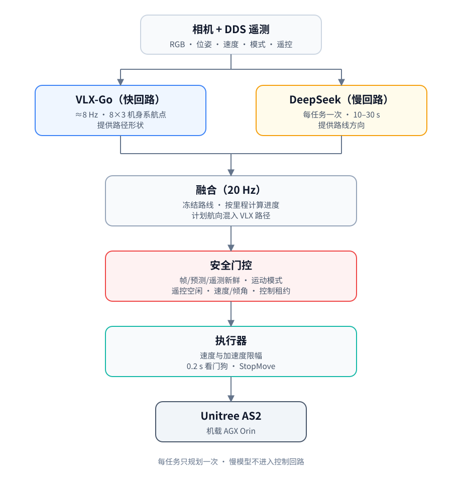
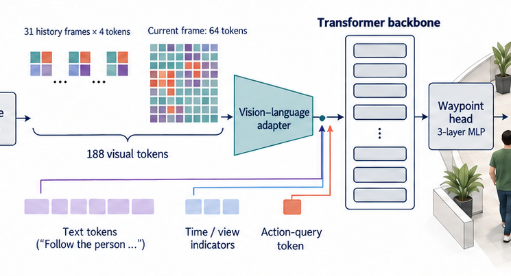
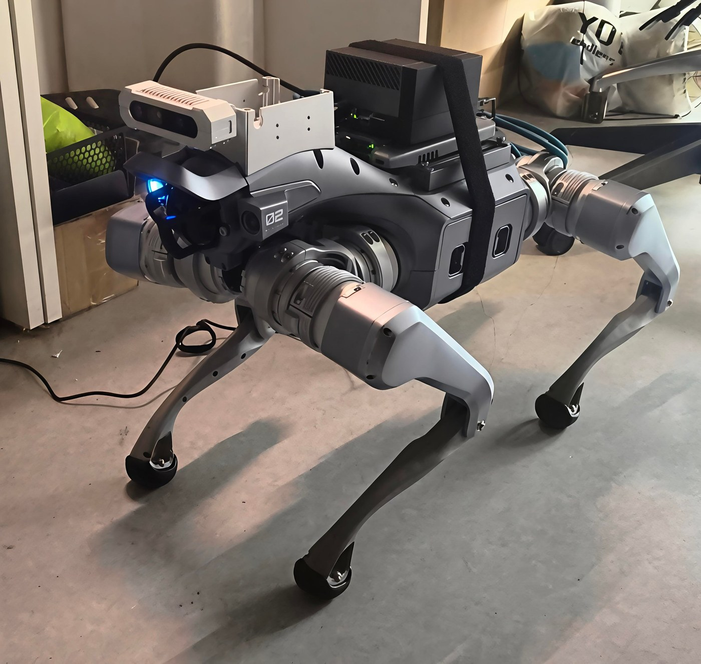
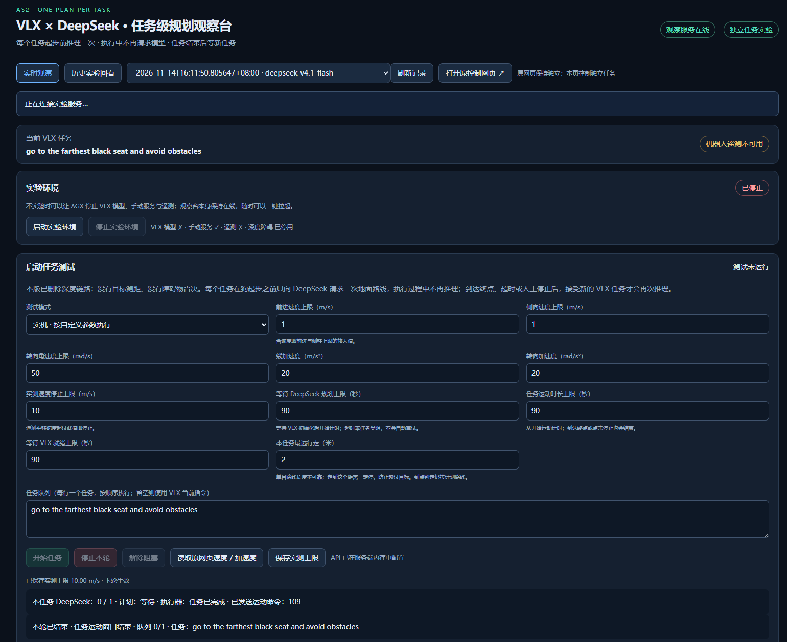
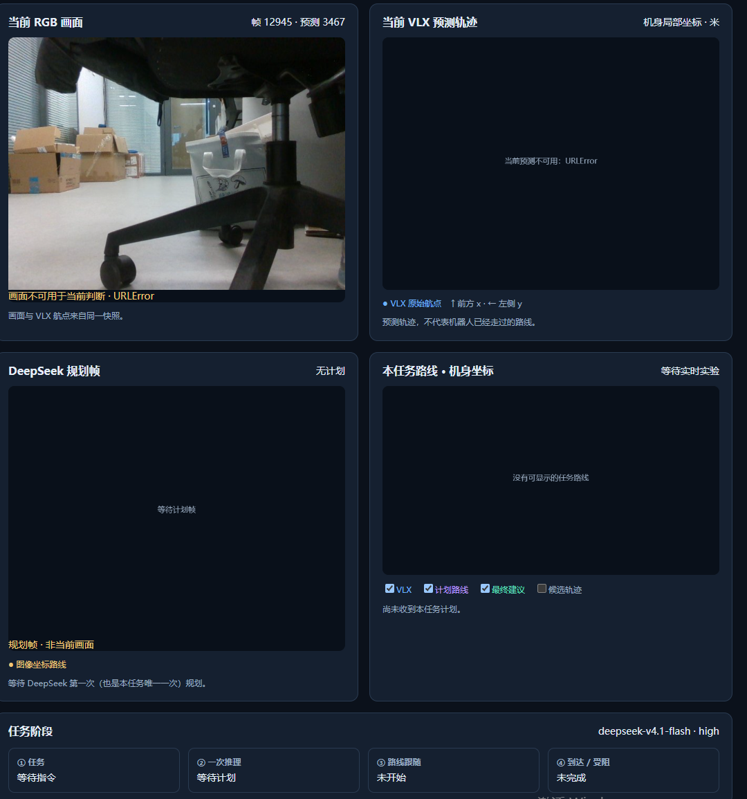
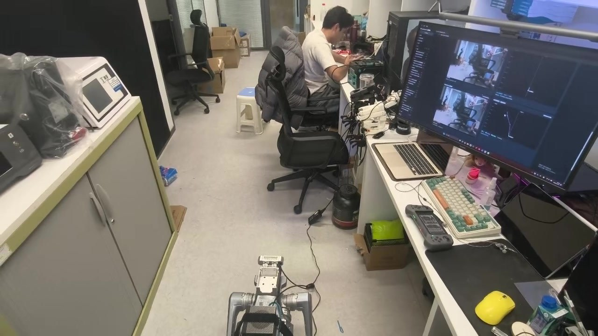

<p align="center">
  
</p>

<h1 align="center">AS2 Track Harness</h1>

<p align="center">
  <b>DeepSeek × VLX。</b>把快 VLA 策略和慢 VLM 规划器接到 Unitree AS2 上的部署
  harness（脚手架）。
</p>

<p align="center">
  <a href="LICENSE"></a>
  
  <a href="#快速开始无需机器人"></a>
  <a href="https://github.com/Appendix41/as2-track-harness/actions/workflows/ci.yml"></a>
  <a href="#安全声明与已知限制"></a>
</p>

<p align="center">
  <a href="README.md">English</a> | 中文
</p>

---

## 这是什么

VLX-Go 小而快：在 Orin 上约 8 Hz，一帧图像进、8×3 机身系航点出。它弱在判断力。在我们
这种杂物多的实验室里，需要理解场景的地方经常出错：几把黑椅子哪把更远、目标躲到障碍
后面该往哪走、画面变了以后路线还成不成立。单目投影还会把距离压扁，"去最远的那把黑
椅子"恰好是它不擅长的指令。

harness 用慢模型补上这一块，并加上让这对模型能在机器人上安全运行的部分。DeepSeek 读
整帧图像和指令，每个任务只在出发前问一次，返回一条地面路线；10–30 s 的延迟因此不进
控制回路。这种分工参考了银河通用把 Astra 接入 VLA 的做法。

- **融合。** 路线投影到机身系后冻结；每 20 ms 用当前位姿重新表达、沿路线算进度，并把
  计划航向按权重混进 VLX 航点，每周期最多 6°。
- **门控。** 图像、预测、遥测都新鲜，机器人处于运动模式，没有其他控制者，遥控空闲，
  速度和倾角在范围内，指令才下发。
- **执行器。** 独立进程再校验一遍，做速度与加速度限幅，带 0.2 s 看门狗，结束时一定发
  `StopMove`。

任务身份是 VLX 的 `task_key`：boot id、流、指令修订号和指令。只有出现新 key 才会重新
规划；任务中途不替换路线。

## 架构

<p align="center">
  
</p>

快策略按相机频率跑，慢规划器每任务一次，所有指令都要过同一道门控。

```
空闲 --新 task_key--> 规划中 --计划被接受--> 执行中 --到达 / 超时--> 完成
                        |                                        |
                        +-- 被拒 / 超时 --> 阻塞 <----------------+
```

坐标契约、融合公式和门控顺序见 [架构文档](docs/ARCHITECTURE.md)。

### VLX-Go 模型

快策略是外部模型，本仓库只消费它的 8×3 输出。结构供参考：

<p align="center">
  <a href="assets/vlx-go-architecture.png"></a>
</p>

- 31 帧历史 × 4 个 token（124），加当前帧 64 个 token，共 188 个视觉 token；
  DINOv3 与 SigLIP 特征经对齐、拼接、池化后每个 token 1536 维。
- 共享 Adapter 把 1536 维映射到 1024 维；指令分词后得到 L 个文本 token，再拼上
  时间标记和 1 个 ACT token。
- Qwen3 做一次前向；ACT 位置的输出经三层 MLP（1024 → 24）得到 8×3 机身系路径点。
- 执行器取第 2 个点 ÷ 0.1 s，作为前向、侧向、转向速度。

张量形状和完整流程见 [docs/VLX_GO.md](docs/VLX_GO.md)。图来自上游项目（om-ai-lab，
arXiv:2610.19361），模型和权重不在本仓库。

## 快速开始（无需机器人）

```bash
git clone https://github.com/Appendix41/as2-track-harness.git
cd as2-track-harness
python3.11 -m venv .venv && . .venv/bin/activate
pip install -e '.[vision]'
bash scripts/test.sh
```

不需要相机、API key 或机器人的 mock 回路：

```bash
bash scripts/mock_preview.sh --port 8765          # 终端 A
bash scripts/shadow.sh --config config/shadow.json --duration 15 --port 0   # 终端 B
```

回放一次录制运行：

```bash
PYTHONPATH=src python -m vlx_async.replay \
  --predictions examples/demo_run/predictions.jsonl --max-records 200
```

## 在 AS2 上运行

<p align="center">
  
</p>

<p align="center"><em>Unitree AS2。前支架是 Intel RealSense D435i；背部 Jetson AGX Orin 跑 VLX-Go、规划客户端和 DDS 栈。</em></p>

仓库里没有模型。需要自备：

- 一个 **VLX-Go 预览服务**，在 `127.0.0.1:8765` 提供 `/control.json` 和 `/state.json`；
- **DDS 遥测**（`unitree_sdk2py` + Cyclone DDS，或 `scripts/telemetry_readonly.sh`
  生成的快照）；
- 一个 **控制租约**（可选带手动控制服务），通过 `VLX_CONTROLLER_LOCK` 和
  `VLX_STACK_ROOT` 指向你的部署；
- 一个 **OpenAI 兼容接口**（`base_url`、`model`、`DEEPSEEK_API_KEY`）。

VLX-Go-1.0 和 SigLIP 权重在 Hugging Face 公开，DINOv3 需要申请，推理代码在
`om-ai-lab/VLX-Go`。推理也可以放到另一台机器，适配器留在机器人主机上
（见 [远程推理](docs/REMOTE_INFERENCE.md)）。

VLX-Go 也可以单独跑：预览服务和 shadow 回路不用规划器就能看到原始 8×3 路径。执行器
仍然要求一份被接受的计划，所以当前版本没有"纯 VLX 实机运动"模式。

<p align="center">
  
</p>

<p align="center"><em>浏览器里的试次页面。限速由操作者每轮填写；截图里是台架测试用的值。仓库默认值低得多（0.05 / 0.03 / 0.10 m/s），第一次实机请从默认值开始。</em></p>

<p align="center">
  
</p>

<p align="center"><em>观察台的几块面板：RGB 画面、VLX 路径、本任务唯一一次 DeepSeek 计划帧、任务路线和任务阶段。这张截图是在预览服务离线时拍的，各面板显示原因（`URLError`），而不是复用过期路线。</em></p>

```bash
DEEPSEEK_API_KEY=... bash scripts/observe.sh --port 8768   # 观察台，仅 loopback
bash scripts/fusion_trial.sh --duration 10                 # dry-run
bash scripts/fusion_trial.sh --execute --duration 5 \
  --speed 0.05 --lateral-speed 0.03 --yaw-speed 0.10 \
  --linear-acceleration 0.10 --yaw-acceleration 0.20
```

首次实机前读 [SAFETY.md](docs/SAFETY.md)，前置条件和报错原因见
[RUNBOOK.md](docs/RUNBOOK.md)。

## 结果

以下都在我们这台 AS2 上运行，指令是 `go to the farthest black seat and avoid
obstacles`。VLX-Go 在机载 Orin 上约 8 Hz，DeepSeek 每个任务只调一次。

<p align="center">
  <a href="assets/demo.mp4"></a>
</p>

<p align="center"><em>演示片段（10 s），点击打开 MP4。</em></p>

| 项目 | 结果 | 样本 | 日期 |
| --- | --- | --- | --- |
| 单元测试 | 170 项通过，纯 CPU | 170 | 2026-11-13 |
| 机载 VLX | 输出约 8.2 Hz，本地回路约 19.9 Hz | 1 次，65 s | 2026-10-25 |
| 规划器延迟 | 每次图像请求 10.3 – 24.0 s | 18 次请求 | 2026-10-25/26 |
| 真机受控会话 | 每次 2 – 172 条 `Move`，最长 55.6 s | 22 次 | 2026-11-10 |

"受控会话"指有时间/行程上限、新鲜计划门控、且有人手持遥控器的试次。每次都停在某个边界上
（速度门控、看门狗、路线/行程上限或人工接管）；到达没有用外部真值测量。

未展示：超过数米的连续导航、真机避障（深度默认关闭）、单目路线的米制精度，以及这台
AS2 之外的机器人。

## 安全声明与已知限制

> [!WARNING]
> 未认证的研究代码，能让一台 20 kg 以上的四足机器人运动。
>
> - 默认没有障碍感知：`motion_gates.json` 和 `depth.json` 出厂都是 `false`。真正兜底的
>   只有遥控器、看门狗、速度/加速度上限和遥测门控。
> - 门控只是和规划客户端跑在同一台机器上的 Python。进程崩溃、内核卡顿、DDS 丢包或机器人
>   故障都能绕过它。
> - 每任务只规划一次，场景中途变化要发新任务。
> - 不提供担保，不含权重，Apache-2.0 as is。

实机时遥控器拿在手里，旁边再站一个人。细节见 [SAFETY.md](docs/SAFETY.md)。

## 文档

- [架构](docs/ARCHITECTURE.md) —— 数据流、任务生命周期、融合、门控顺序。
- [安全](docs/SAFETY.md) —— 上限、停止行为、系统不提供什么。
- [运行手册](docs/RUNBOOK.md) —— 安装、演示、观察台、实机检查表。
- [配置](docs/CONFIGURATION.md) —— 每个字段和取值范围。
- [远程推理](docs/REMOTE_INFERENCE.md) —— 把规划器放到机器人之外。
- [示例](examples/README.md) —— 录制任务与回放方法。

贡献流程见 [CONTRIBUTING.md](CONTRIBUTING.md)，安全问题走 [SECURITY.md](SECURITY.md)。

## 许可

Apache-2.0。不分发任何模型权重；VLX-Go、DINOv3、SigLIP 遵循各自许可证。第三方归属见
[NOTICE](NOTICE)。

如果这个 harness 对你的工作有帮助：

```bibtex
@software{as2_track_harness_2026,
  title  = {AS2 Track Harness (DeepSeek × VLX): an asynchronous VLA + VLM navigation harness for the Unitree AS2},
  author = {{AS2 Track Harness contributors}},
  year   = {2026},
  url    = {https://github.com/Appendix41/as2-track-harness},
  note   = {Research prototype; not safety certified}
}
```
