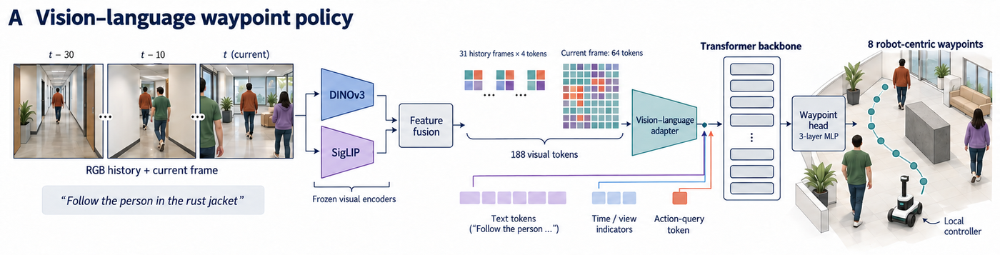

# VLX-Go model

The fast policy is upstream: [om-ai-lab/VLX-Go](https://github.com/om-ai-lab/VLX-Go)
(arXiv:2610.19361). This repository consumes its 8×3 waypoint output; it does not
reimplement the model, and no weights are redistributed. The notes below exist so
the code and the numbers in the paper are easier to follow.

<p align="center">
  <a href="../assets/vlx-go-architecture.png"></a>
</p>

## Tensors

| Stage | Shape |
| --- | --- |
| Current frame | 384 × 384 × 3 |
| Vision features, DINOv3 + SigLIP (aligned, concatenated, pooled) | 64 × 1536 |
| History, 31 frames × 4 tokens | 124 × 1536 |
| Shared adapter | 1536 → 1024 |
| Current + history after the adapter | 64 × 1024 + 124 × 1024 |
| Instruction tokens | L × 1024 |
| Sequence into Qwen3 | (L + 221) × 1024 |
| Action-token position after one forward pass | 1024 |
| Three-layer MLP | 1024 → 24 |
| Reshape and per-dimension scale | 8 × 3 waypoints |
| Executor conversion | waypoint[1] / 0.1 s → `vx, vy, wz` |

## Flow

```text
current frame 384×384×3
  → DINOv3 + SigLIP: feature alignment, concatenation, pooling
current tokens 64×1536
history cache 31 frames × 4 × 1536 → flatten to 124×1536
  → shared adapter 1536 → 1024
current 64×1024 + history 124×1024
instruction → tokenizer + embedding → L×1024
concatenate: text + time-tagged history + time-tagged current + ACT
  → (L+221)×1024
  → Qwen3, one forward pass
  → keep the ACT position: 1024
  → three-layer MLP → 24
  → reshape + per-dimension scale → 8×3 local waypoints
  → waypoint[1] / 0.1 s → [forward, lateral, yaw] velocity
```

## Contract used by this harness

- The 8×3 points are in the current body/motion frame: `x` forward (m), `y` left
  (m), `yaw` counter-clockwise (rad).
- The executor takes `recommended[1]` as the velocity target and applies its own
  limits. See [ARCHITECTURE.md](ARCHITECTURE.md) and `src/vlx_async/execution.py`.
- The slow planner is independent of this model; it is asked once per task for a
  route in image space. See [ARCHITECTURE.md](ARCHITECTURE.md#4-fusion-math).

The architecture image is from the VLX-Go project/paper (om-ai-lab) and is included
for reference. The model, its code and its weights stay under the upstream licence.
